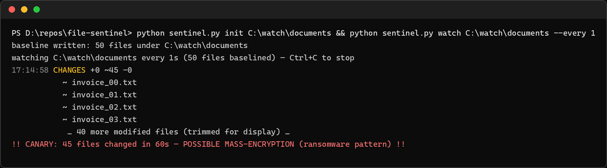

# file-sentinel

[](https://github.com/amanvicky/file-sentinel/actions/workflows/ci.yml)

**Real-time file-integrity watching with a ransomware canary.** Record a SHA-256 baseline of a folder once; from then on every created, modified or deleted file prints the moment it happens — and if too many files change inside one window, the canary screams. Zero dependencies, stdlib only.



That run is real: 50 files baselined, a process rewrote 45 of them within seconds, and the alert fired exactly the way ransomware's first minute looks. A folder of invoices becomes a tripwire.

## ⚠️ Run at your own responsibility

This is a **defensive, educational tool**. It watches whatever folder you point it at — that visibility is yours to use wisely:

- **Only monitor folders on machines you own**, or with written authorization from whoever does.
- **Know your local rules** about monitoring shared machines and employee folders.
- **The canary is a detector, not a blocker** — it tells you something ugly is happening; deciding what to do next is your responsibility, in your jurisdiction, on your systems.
- The author is not responsible for what happens on your deployment. If that's unclear, don't run it yet.

## How it works

| Command | Job |
|---|---|
| `init ROOT` | SHA-256 baseline of every file, stored beside the folder as `.sentinel-baseline.json` |
| `watch ROOT` | diffs against the baseline every `--every` seconds, live feed + JSONL; the **canary** fires when `--threshold` changes land within `--window` seconds; `--webhook URL` POSTs canary alerts |
| `check ROOT` | one-shot diff against the baseline — the cron-friendly version |

Content changes only count — touching a file's mtime without changing its bytes is silence (the tests assert that). Alerts land in `sentinel.jsonl`:

```json
{"ts": "2026-11-12T17:14:58+00:00", "kind": "canary", "changes_in_window": 45, "window_seconds": 60, "threshold": 40}
```

## Run

```bash
python sentinel.py init C:\watch\documents
python sentinel.py watch C:\watch\documents --every 2 --threshold 40 --webhook http://your-endpoint/hook
pytest tests/ -q      # 9 tests, stdlib only
```

## Honest scope

Polling every few seconds, not filesystem event streams — near-real-time, not per-syscall. It detects and reports; it does not quarantine, kill processes, or restore files. Pair it with backups, and treat it as the tripwire — not the wall.

Built by a cybersecurity trainer for the classroom: the fastest way to *show* students what a ransomware first minute looks like on their own machine — safely, on a folder full of fake invoices.
